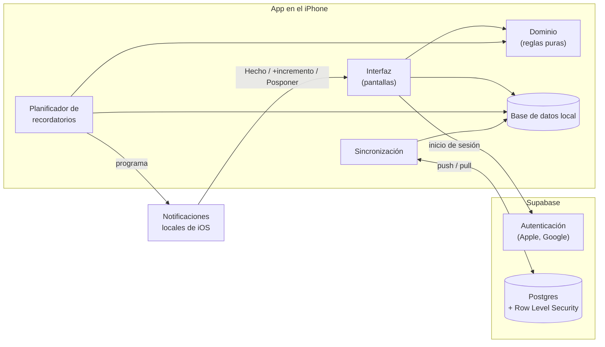
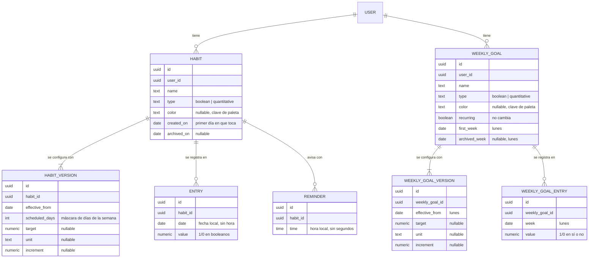

# Arquitectura

Cómo se construye la aplicación descrita en la [especificación funcional](especificacion-funcional.md). Las decisiones importantes se justifican en los [ADR](adr/); este documento resume el resultado.

## 1. Objetivos de calidad

Derivados de los principios de la especificación funcional:

| Prioridad | Objetivo | Qué implica |
|-----------|----------|-------------|
| 1 | **Recordatorios fiables** | Se generan en el propio dispositivo; no dependen de conexión ni de un servidor. |
| 2 | **Funciona sin conexión** | El dispositivo guarda los datos y es la fuente de verdad para la interfaz. La nube es copia y sincronización. |
| 3 | **Respuesta inmediata** | Marcar un hábito no espera a la red. |
| 4 | **Simplicidad** | Mínimo número de piezas, servicios gestionados, nada de servidores propios. |
| 5 | **Coste cero o casi** | Solo el Apple Developer Program es de pago. |

## 2. Visión general



- La **interfaz** solo lee y escribe en la base de datos local, así que nunca espera a la red.
- El **dominio** no accede a la base de datos ni a ninguna otra pieza: recibe los datos que le pasan la interfaz o el planificador y devuelve el resultado.
- La **sincronización** copia los cambios entre la base local y Supabase en segundo plano.
- El **planificador de recordatorios** calcula qué avisos tocan y los programa como notificaciones locales de iOS.

## 3. Tecnologías

| Área | Elección | Decisión |
|------|----------|----------|
| Plataforma | Expo (React Native) con TypeScript en modo estricto | [ADR-0002](adr/0002-expo-como-plataforma.md) |
| Navegación | Expo Router (rutas basadas en ficheros): el día como única pantalla principal, sin cabecera, y los formularios como modales | [ADR-0010](adr/0010-interfaz-por-gestos-hooks-propios-sobre-expo-sqlite-y-estilos-sin-libreria.md) |
| Gestos y animaciones | `react-native-gesture-handler` y `react-native-reanimated`: el calendario, el menú y las opciones de un hábito son capas de la pantalla principal | [ADR-0010](adr/0010-interfaz-por-gestos-hooks-propios-sobre-expo-sqlite-y-estilos-sin-libreria.md) |
| Datos en la interfaz | Hooks propios sobre una conexión única de `expo-sqlite`, sin caché ni store global | [ADR-0010](adr/0010-interfaz-por-gestos-hooks-propios-sobre-expo-sqlite-y-estilos-sin-libreria.md), [ADR-0012](adr/0012-botones-de-los-recordatorios-en-segundo-plano-con-javascript.md) |
| Estilos | `StyleSheet` con tokens propios, sin librería de UI; solo modo oscuro, con acento violeta y una paleta aparte para los colores de los hábitos | [ADR-0010](adr/0010-interfaz-por-gestos-hooks-propios-sobre-expo-sqlite-y-estilos-sin-libreria.md), [ADR-0013](adr/0013-estetica-oscura-unica-con-acento-violeta.md), [ADR-0014](adr/0014-colores-de-habito-como-dato-del-usuario-guardados-como-clave-de-paleta.md) |
| Iconos | SF Symbols con `expo-symbols`, con un sustituto sencillo donde no hay | [ADR-0011](adr/0011-sf-symbols-con-expo-symbols-para-los-iconos.md) |
| Base de datos local | SQLite (`expo-sqlite`), con SQL directo y migraciones propias | [ADR-0004](adr/0004-offline-first-con-sincronizacion.md), [ADR-0009](adr/0009-sql-directo-y-migraciones-propias-en-la-capa-de-datos-local.md) |
| Backend y autenticación | Supabase (Postgres, Auth) | [ADR-0003](adr/0003-supabase-como-backend.md) |
| Inicio de sesión | Sign in with Apple (`expo-apple-authentication`) y Google (`@react-native-google-signin/google-signin`) nativos, con el token enviado a Supabase; la sesión, en el llavero de iOS (`expo-secure-store`) | [ADR-0003](adr/0003-supabase-como-backend.md), [ADR-0017](adr/0017-inicio-de-sesion-nativo-con-apple-y-google-y-sesion-en-el-llavero.md) |
| Recordatorios | Notificaciones locales (`expo-notifications`) y tarea en segundo plano (`expo-background-task`) | [ADR-0005](adr/0005-recordatorios-locales-en-ventana-deslizante.md) |
| Compilación y publicación | EAS Build, EAS Submit y TestFlight | [ADR-0002](adr/0002-expo-como-plataforma.md) |
| Actualizaciones | EAS Update (OTA), con la versión de runtime por huella nativa | [ADR-0020](adr/0020-actualizaciones-ota-con-eas-update-primero-en-desarrollo-y-despues-en-produccion.md) |
| Versiones | Versionado semántico, con un tag por publicación | [ADR-0024](adr/0024-versiones-visibles-con-versionado-semantico-y-un-tag-por-publicacion.md) |
| Vibraciones | Generadores de iOS con `expo-haptics` (RF-39) | Estándar de Expo |
| Tests | Jest y React Native Testing Library | Estándar de Expo |
| Tests del esquema de la nube | pgTAP contra la base local de Supabase, en la CI | [ADR-0015](adr/0015-pruebas-del-esquema-de-supabase-con-pgtap-en-la-ci.md) |
| Calidad de código | ESLint y Prettier | Estándar de Expo |
| Variantes | Desarrollo y producción, con identidad propia cada una | [ADR-0008](adr/0008-variantes-de-desarrollo-y-produccion.md) |
| Idioma | Código en inglés, documentación en español | [ADR-0007](adr/0007-codigo-en-ingles-y-documentacion-en-espanol.md) |

Las versiones concretas se fijan al crear el proyecto y quedan registradas en `package.json`.

## 4. Capas y estructura del código

```
src/
  app/            Pantallas y navegación (Expo Router: cada fichero es una ruta)
  domain/         Reglas de negocio puras, sin dependencias de React ni de la base de datos
  data/           Acceso a la base de datos local (esquema, migraciones, repositorios)
  sync/           Sincronización con Supabase
  notifications/  Planificador de recordatorios y gestión de acciones
  auth/           Inicio y cierre de sesión, eliminación de cuenta
  ui/             Componentes visuales reutilizables, tokens de estilo y hooks de datos de las pantallas
supabase/         Migraciones SQL, políticas de seguridad y Edge Functions del backend
```

Regla de dependencias: `app` y `ui` pueden usar todo; `domain` no depende de nada. Así las reglas más delicadas (qué hábitos tocan un día, cuándo está cumplido, qué recordatorios hay que programar) son funciones puras que se prueban con tests unitarios rápidos. ESLint impone esta regla en `src/domain`.

Convenciones del dominio:

- **No consulta el reloj ni genera identificadores.** "Hoy" y los UUID se le pasan como datos, así que el mismo dato de entrada da siempre el mismo resultado.
- **Las reglas que pueden rechazar una operación devuelven códigos de error** (por ejemplo, `name_empty`), no textos. La interfaz decide el mensaje.
- **Los tests van junto al código** (`dates.ts` y `dates.test.ts`) y la cobertura del dominio, de la capa de datos, de la sincronización (salvo su adaptador de Supabase) y de las Edge Functions (salvo su punto de entrada, `index.ts`) debe ser del 100 %: `npm run verify` falla si baja. Lo que queda fuera se prueba de punta a punta en la CI.
- **La capa de datos** (`src/data`) solo depende del dominio, y sus repositorios usan una interfaz mínima de base de datos en lugar de `expo-sqlite`. Así los tests ejecutan el SQL real con el SQLite integrado en Node ([ADR-0009](adr/0009-sql-directo-y-migraciones-propias-en-la-capa-de-datos-local.md)). ESLint impone también esta dependencia.
- **Una operación cada vez en la conexión** (`src/data/serialized-database.ts`). En `expo-sqlite`, una sentencia lanzada durante una transacción entra en ella y se pierde si esta falla, y dos transacciones a la vez dan error. Por eso todas las operaciones esperan su turno en una cola, y lo que se hace dentro de una transacción va por el `tx` que esta recibe: usar la base exterior se quedaría esperando para siempre. Los tests usan la misma cola, así que ese error los haría fallar. La base funciona en modo WAL, que abarata cada commit y no necesita migración.

Las pantallas están en `src/app/` porque es la ubicación de la plantilla de Expo; dentro solo van rutas, y los tests van fuera (en `src/__tests__/` o junto al código que prueban, fuera de `src/app/`). Los imports usan el alias `@/` → `src/`.

## 5. Modelo de datos

La especificación exige que los cambios en un hábito se apliquen solo hacia delante (RF-09) y que los días pasados muestren lo que tocaba entonces. Por eso la configuración de un hábito se guarda con **fecha de vigencia** ([ADR-0006](adr/0006-configuracion-de-habitos-con-vigencia.md)).

Los nombres del modelo están en inglés ([ADR-0007](adr/0007-codigo-en-ingles-y-documentacion-en-espanol.md)); su equivalencia con los términos de la especificación está en el [glosario](especificacion-funcional.md#2-glosario).



Decisiones del modelo:

- **Las fechas son fechas de calendario** (`2026-10-28`), no instantes con hora. El día va de 00:00 a 23:59 en la hora local del dispositivo y no cambia si el usuario viaja a otra zona horaria.
- **Qué hábitos tocan el día D:** los que empiezan como mucho en D, no están retirados por archivado en D y, según la versión vigente en D (la de mayor `effective_from` que sea ≤ D), están programados para ese día de la semana.
- **Archivado:** un hábito archivado deja de tocar a partir del día siguiente al archivado. El propio día del archivado solo toca si ya tiene algo registrado (RF-10). Archivar no se deshace: `archived_on` es una sola fecha, y reactivar exigiría guardar periodos de actividad para que los días intermedios no aparezcan como incumplidos (fuera del alcance del MVP).
- **Inicio de un hábito:** `created_on` es el primer día en que el hábito toca, no el día en que se pulsó Guardar. Un hábito creado desde un día futuro empieza ese día; desde hoy o desde un día pasado, hoy (RF-06). Su primera versión tiene el mismo `effective_from`.
- **Edición desde cualquier día:** la configuración nueva siempre entra en vigor el día actual (`effective_from` = hoy), aunque se edite desde un día pasado o futuro (RF-09). Lo que pertenece al día que se está viendo es su registro. La excepción es un hábito que aún no ha empezado: sus cambios entran en vigor el día en que empieza, para no crear versiones anteriores al hábito.
- **Color:** `color` guarda la clave de un color de la paleta (`blue`, `teal`…) o nada, no su valor; el tono de cada clave lo decide la interfaz ([ADR-0014](adr/0014-colores-de-habito-como-dato-del-usuario-guardados-como-clave-de-paleta.md)). Como el nombre, no tiene versiones: cambia en todo el historial.
- **Días programados:** máscara de 7 bits en `scheduled_days`, con el lunes en el bit 0 y el domingo en el bit 6.
- **Cantidades:** `target`, `increment` y `value` tienen 2 decimales como máximo y nunca son negativas. Un registro con valor 0 cuenta como no hecho, pero sigue siendo un registro: mantiene el hábito o el objetivo a la vista ese día o esa semana aunque ya no toque o se haya archivado, para poder volver a marcarlo (RF-09, RF-10, RF-44). Los recordatorios y los avisos solo cuentan los días programados (`scheduledHabitsForDay`).
- **Un registro por hábito y día** (clave única `habit_id + date`). Si no hay registro, el hábito está pendiente.
- **Las horas son horas del día** (`08:30`), con precisión de minuto y sin zona horaria, igual que las fechas.
- **Los recordatorios no tienen versiones**: solo afectan al futuro. Un hábito no puede tener dos a la misma hora (clave única `habit_id + time`).
- **Qué recordatorios se programan:** a partir de ahora y por cercanía, los de cada hábito en sus días programados, salvo que el hábito esté cumplido ese día o archivado. Como mucho 60 ([ADR-0005](adr/0005-recordatorios-locales-en-ventana-deslizante.md)). Cada aviso lleva el progreso del hábito ese día para poder mostrarlo.
- **Ayuda del gesto:** si ya se ha usado un botón y desde qué día se explica se guardan en el almacén clave-valor de `expo-sqlite`, solo en el dispositivo (RF-25). Va fuera de la base a propósito: el arranque se niega a abrir una base con un esquema más nuevo que la app, así que una migración impediría deshacer con seguridad la actualización OTA que la añadiera.
- **Avisos de pendientes:** dos al día a horas fijas (17:00 y 22:00), los días en que queda algún hábito sin cumplir (RF-37). No se guardan en la base: se calculan, como los recordatorios. Comparten la ventana de 60 con ellos (ver "Programar los recordatorios").
- **Avisos de progreso:** dos a la semana a horas fijas (jueves a las 20:00 y domingo a las 11:00), si quedan objetivos de esa semana sin conseguir (RF-49). Tampoco se guardan en la base y van en la misma ventana.
- **Objetivos semanales:** tablas propias con la misma forma que los hábitos, y un único total por objetivo y semana (clave única `weekly_goal_id + week`). Las semanas se guardan por su lunes. Qué objetivos tocan una semana se calcula con `first_week`, `recurring` y `archived_week` (RF-44, RF-48) ([ADR-0022](adr/0022-objetivos-semanales-en-tablas-propias-con-un-total-por-semana.md)).
- **Campos de sincronización** en todas las tablas: identificador generado en el dispositivo (UUID), `updated_at` asignado por el servidor y `deleted` (borrado lógico) para propagar eliminaciones.
- **En la base local** no existe `user_id` (es de un solo usuario) y cada tabla añade `pending_sync`, que marca las filas con cambios sin subir. Las claves únicas ignoran las filas borradas. Dos tablas solo existen en el dispositivo y guardan el estado de la sincronización: `sync_cursors`, hasta dónde ha bajado cada tabla, y `sync_account`, de qué cuenta son los datos ([ADR-0018](adr/0018-sincronizacion-con-pull-antes-que-push-y-union-por-clave-natural.md)).
- **Migraciones locales:** lista ordenada en `src/data/migrations.ts`; la base guarda su versión y al abrir se aplican las que faltan. Una migración publicada no se edita.
- **En la nube** (`supabase/migrations`) están las mismas tablas, columnas y claves únicas, con estas diferencias a propósito:
  - Cada tabla añade `user_id`, que por defecto es el usuario de la sesión y se borra en cascada con la cuenta.
  - Los tipos son los de Postgres: `uuid`, `date`, `boolean` y `double precision`. Las horas siguen siendo texto `HH:MM`.
  - `updated_at` es obligatorio y lo asigna un trigger ([ADR-0016](adr/0016-cursor-de-sincronizacion-serializado-por-usuario.md)).
  - Las claves foráneas incluyen `user_id`, para que una fila solo pueda colgar de un hábito de su mismo usuario.
- **Migraciones de la nube:** ficheros SQL en `supabase/migrations`, que se aplican a cada proyecto con la CLI de Supabase. Tampoco se editan una vez aplicados. Un cambio de esquema lleva las dos migraciones, la local y la de la nube, en el mismo Pull Request. Un test de la CI comprueba que las dos tienen las mismas columnas ([ADR-0015](adr/0015-pruebas-del-esquema-de-supabase-con-pgtap-en-la-ci.md)).

## 6. Flujos principales

### Marcar un hábito

1. La interfaz escribe el registro en la base local y se actualiza al instante. Solo cambia el estado de la fila: la pantalla conserva los grupos (pendientes arriba, cumplidos abajo) y el orden que calculó al mostrar el día, y la lista se reagrupa la próxima vez que se muestra (RF-12).
2. El planificador cancela los recordatorios restantes de ese hábito para hoy si ya está cumplido (RF-24).
3. La sincronización sube el cambio cuando hay conexión.

### Cambiar de día

1. El día que se ve es estado de la pantalla principal ([ADR-0010](adr/0010-interfaz-por-gestos-hooks-propios-sobre-expo-sqlite-y-estilos-sin-libreria.md)). El calendario es una hoja que baja desde arriba con el mismo componente que el menú, que sale desde abajo.
2. La lista solo tira del calendario cuando está arriba del todo: su gesto convive con el scroll y se ignora si la lista puede seguir subiendo.
3. Los meses se colocan uno junto a otro y la fila se desplaza con el dedo. El dominio da las semanas de cada mes, que empiezan en lunes.
4. Al elegir un día se lee ese día de la base y se calculan sus grupos y su orden. El dominio recibe la hora solo si el día es el actual: con ella ordena por lo vencido y lo próximo; sin ella, por el primer recordatorio (RF-12). Volver de un formulario conserva el día; volver a la app desde el segundo plano muestra el día actual; a medianoche la pantalla solo cambia de día si se estaba viendo el actual (RF-12).

### Opciones de un hábito

1. El dominio decide qué opciones tiene un hábito según el día que se ve y si está archivado (RF-34). La interfaz las muestra en la misma hoja inferior que el menú.
2. Restar el incremento y escribir la cantidad exacta siguen el flujo de "Marcar un hábito". La cantidad se pide con el diálogo nativo de iOS (`Alert.prompt`), y archivar y eliminar se confirman con una alerta nativa.
3. Editar abre el formulario como modal, el mismo que el de crear. Al guardar, el nombre y el color cambian en el hábito y la configuración entra en vigor hoy: se añade una versión nueva o, si ya había una de hoy, se actualiza. Los recordatorios añadidos y quitados se guardan en la misma transacción. Un formulario con cambios pide confirmación antes de cerrarse (RF-52): `usePreventRemove` de Expo Router intercepta tanto "Cancelar" como el gesto nativo de deslizar el modal.

### Programar los recordatorios

1. Al abrir la app se pide el permiso de notificaciones si aún no se ha pedido (RF-35). iOS solo lo pregunta una vez: después, solo se cambia desde los ajustes del teléfono.
2. El planificador (`src/notifications`) se ejecuta al abrir la app, al volver a primer plano, tras cada cambio en hábitos, objetivos, registros o recordatorios y, con la app cerrada, en una tarea en segundo plano (`expo-background-task`). Esa tarea se pide a iOS cada 12 horas como mínimo, pero iOS decide si la ejecuta y cuándo; sirve para que la ventana no se agote si la app no se abre en días. Refresca primero, sincroniza con un límite de 20 s y vuelve a refrescar, para que una red lenta no le impida hacer lo importante. El dominio calcula los próximos 60 avisos (recordatorios, avisos de pendientes y avisos de progreso), y el planificador los compara con las notificaciones ya programadas: solo cancela las que ya no tocan o han cambiado y solo programa las que faltan. Así, refrescar tras cada toque es barato.
3. Cada aviso tiene un identificador estable (`reminder.<recordatorio>.<fecha>`) y guarda en sus datos el día, la hora y una firma con el instante, el día, la hora, el texto y la categoría. Al leerla de vuelta, iOS devuelve la fecha programada como un intervalo, así que la comparación se hace con la firma. El instante forma parte de ella porque iOS guarda un intervalo fijo: al cambiar de zona horaria, la firma cambia y los avisos se reprograman para seguir sonando a su hora local. Las pospuestas se tratan aparte (ver "Acción desde un recordatorio").
4. Los avisos de pendientes (RF-37) van en la misma ventana. El dominio calcula los próximos de cada día con hábitos sin cumplir, y nombra esos hábitos en el orden en que la vista del día los mostraría a esa hora (RF-12). Como no se puede ejecutar código justo antes de que iOS muestre una notificación, el aviso de hoy se cancela al refrescar en cuanto ya no queda nada pendiente, y su texto cambia con cada registro. Los de días futuros nombran todos los hábitos de ese día y se corrigen al refrescar ese día. Tienen su propio identificador (`digest.<fecha>.<hora>`), no tienen categoría ni botones, porque reúnen varios hábitos, y no llevan hábito en sus datos. Por eso, al tocarlos solo se abre la app en el día actual. La ventana junta recordatorios y avisos por cercanía y se queda con los 60 primeros. A la misma hora va antes el recordatorio. Los dos avisos diarios acortan los días que cubre la ventana: con 5 recordatorios al día, pasa de unos 12 días a unos 8.
   Los avisos de progreso (RF-49) funcionan igual, con identificador `progress.<fecha>.<hora>`. Se calculan los 4 próximos momentos (dos semanas), para que no queden meses de avisos programados si la app deja de abrirse. No tienen hueco reservado: el siguiente solo quedaría fuera de la ventana con 14 notificaciones o más al día. Los objetivos archivados no cuentan, aunque sigan a la vista esa semana (RF-44).
   El **aviso final** (RF-51) ocupa el último hueco cuando los avisos llenan la ventana, es decir, cuando hay más por llegar de los que iOS puede guardar. Suena a las 12:00 del día anterior al último aviso o, si ese momento ya ha pasado, con él. Su identificador es fijo (`final-notice`), así que cada refresco lo aplaza sustituyéndolo, sin cancelarlo antes. Por eso solo suena si durante toda la ventana no se ha abierto la app, no se ha usado un botón y no ha corrido la tarea en segundo plano. Quien solo tiene objetivos no lo recibe: sus avisos de progreso no llenan la ventana.
   Al tocar una notificación, la pantalla principal va a su horizonte: Objetivos semanales para un aviso de progreso y Hábitos para lo demás, siempre en el día actual. La petición espera en `src/ui/horizon-request.ts` si el toque es lo que arranca la app. Un formulario abierto se queda encima, sin perder lo escrito, y los botones de la notificación no mueven la pantalla.
5. Las ejecuciones van una detrás de otra, y las peticiones que llegan mientras otra espera se agrupan en una sola. Un aviso que falla al programarse (iOS rechaza un momento que acaba de pasar) no detiene los siguientes, y se reintenta en la próxima ejecución.
6. Al guardar un hábito con recordatorios sin permiso, un diálogo lo avisa y ofrece abrir los ajustes (RF-36). El hábito se guarda igualmente: como la app refresca al volver a primer plano, los recordatorios se programan en cuanto el usuario da el permiso.
7. Los recordatorios que llegan con la app abierta también se muestran.

El planificador usa el dominio y la capa de datos. De `src/ui` usa el reloj, el formato de cantidades, la apertura de la base y la petición de horizonte, que deberían vivir en una capa compartida ([estado](estado.md#qué-viene-después)). Su lógica depende de la interfaz `Notifier`, y no de `expo-notifications`, para que los tests se ejecuten sin iOS.

### Acción desde un recordatorio

1. iOS muestra la notificación con sus botones: "Hecho" en los booleanos o "+incremento" en los cuantitativos (por ejemplo, "+0,25 L"), y "Posponer 1 h". Los booleanos comparten una categoría y cada cuantitativo tiene la suya, porque el botón muestra su incremento. Las categorías se registran al refrescar los recordatorios.
2. La respuesta se atiende en JavaScript sin abrir la app ([ADR-0012](adr/0012-botones-de-los-recordatorios-en-segundo-plano-con-javascript.md)). Por si iOS arranca la app solo para entregarla, la entrada propia (`index.ts`) empieza a escuchar antes que Expo Router y abre la misma conexión a la base que usan las pantallas.
3. "Hecho" y "+incremento" apuntan en el día del recordatorio, con las mismas reglas que un toque en la lista, salvo que "Hecho" nunca desmarca. Después se refrescan los recordatorios, lo que cancela los que quedan del día si el hábito ya está cumplido (RF-24). Si la app está en pantalla, el día se vuelve a leer sin reordenarse.
4. "Posponer" programa una notificación nueva (`snooze.<hábito>.<fecha>.<hora>`) para una hora después, con el mismo contenido. Si esa hora cae en el día siguiente, no programa nada. Las pospuestas no forman parte de la ventana de 60: usan el margen que deja hasta las 64 de iOS. Al refrescar, se cancelan las de hábitos ya cumplidos, archivados o eliminados, y las de otros días.
5. Tocar el recordatorio fuera de sus botones solo abre la app, que muestra el día actual (RF-26).

### Inicio y cierre de sesión

1. Sin sesión, la app solo muestra la pantalla de inicio de sesión (RF-01): las rutas protegidas de Expo Router (`Stack.Protected`) dejan fuera las demás, también si se llega a ellas por un enlace. El inicio de sesión nativo de Apple o Google devuelve un token, que se envía a Supabase con `signInWithIdToken` ([ADR-0017](adr/0017-inicio-de-sesion-nativo-con-apple-y-google-y-sesion-en-el-llavero.md)):
   - **Apple:** con nonce. La app pasa a Apple el hash SHA-256 de un valor aleatorio y a Supabase el valor, para que un token interceptado no sirva.
   - **Google:** sin nonce, porque la versión gratuita de la librería no lo admite ("Skip nonce check" en Supabase).
   - Una cancelación no muestra nada. Cualquier otro fallo pide comprobar la conexión e intentarlo de nuevo.
2. **La sesión (RF-02)** la guarda el cliente de Supabase en el llavero de iOS, troceada en fragmentos de menos de 2 KB y legible tras el primer desbloqueo, también en segundo plano. El cliente renueva el token solo con la app en primer plano. Al abrir la app no se muestra nada hasta leer la sesión, para que la pantalla de inicio de sesión no aparezca un instante.
3. Las filas locales no llevan `user_id`: el dispositivo solo tiene los datos de una cuenta a la vez. Al subirlas, Supabase les asigna el usuario de la sesión.
4. **Primer inicio de sesión (RF-38):** la primera sincronización sube todo lo que hay en la base local y baja lo que ya tenía la cuenta. Como los identificadores son UUID generados en cada dispositivo, no chocan, y el resultado es la unión de los dos.
5. **Cerrar sesión (RF-03),** desde **Ajustes** en el menú: primero se intenta sincronizar durante 5 segundos como mucho. Si aun así quedan filas con `pending_sync = 1` (salvo las creadas y eliminadas sin llegar a subirse), la interfaz avisa de que se perderán. Mientras se cierra la sesión, la sincronización espera: una bajada que terminara después de vaciar la base devolvería los datos. Después se vacía la base local, se cancelan las notificaciones programadas y se retiran las ya mostradas, se olvida la cuenta de Google del dispositivo y se cierra la sesión de Supabase **solo en este dispositivo** (`scope: "local"`; por defecto la cerraría en todos). Los datos se borran antes de cerrar la sesión: si algo falla a medias, la sesión sigue abierta y se puede reintentar.
6. **Eliminar la cuenta (RF-04),** desde **Ajustes**, tras una alerta de confirmación ([ADR-0019](adr/0019-eliminacion-de-la-cuenta-con-una-edge-function-que-revoca-sign-in-with-apple-antes-de-borrar-al-usuario.md)):
   1. Si la cuenta usa Apple, la app vuelve a pedir el inicio de sesión con Apple, sin pedir datos, para obtener un código de autorización nuevo.
   2. La sincronización espera y la app llama a la Edge Function `delete-account` con el token de la sesión y, si lo hay, el código.
   3. La función comprueba al usuario con Auth. Si tiene identidad de Apple, cambia el código por un token, comprueba que es del mismo Apple ID y lo revoca. Después borra al usuario, y la cascada borra sus datos. En este orden, un fallo siempre se puede reintentar.
   4. Solo si la función confirma el borrado, la app vacía la base local, cancela y retira las notificaciones, revoca el acceso de Google si se entró con Google en el dispositivo y cierra la sesión local. Lo intenta todo aunque falle un paso: la cuenta ya no existe.

### Sincronización

Cada sincronización (`src/sync/synchronize.ts`) hace primero el pull y después el push, tabla a tabla y con los hábitos antes que sus versiones, registros y recordatorios, que dependen de ellos por clave foránea ([ADR-0018](adr/0018-sincronizacion-con-pull-antes-que-push-y-union-por-clave-natural.md)):

1. **Dueño de los datos:** la primera sincronización apunta en `sync_account` la cuenta de la sesión, y lo que había en el dispositivo pasa a ser de ella (RF-38). Si sincroniza otra cuenta, porque una sesión terminó sin cerrarla, los datos del dispositivo se borran antes de seguir.
2. **Pull:**
   - Se descargan las filas que el servidor ha modificado desde el cursor de cada tabla (`sync_cursors`), por páginas en orden de `(updated_at, id)`. El servidor pone en fila las escrituras de cada usuario antes de asignar `updated_at`, así que ninguna fila se confirma con una marca anterior a otra ya vista ([ADR-0016](adr/0016-cursor-de-sincronizacion-serializado-por-usuario.md)). Las filas de una misma transacción pueden compartir marca, por eso el cursor incluye el `id`.
   - Aplicar una fila no toca las que tienen cambios sin subir: esos cambios ganan y suben a continuación.
   - Si una fila de la cuenta tiene la misma clave natural que una local pendiente (el mismo hábito y día, por ejemplo), la local toma el `id` de la cuenta y conserva sus valores.
3. **Push:**
   - Se suben las filas con `pending_sync = 1` y se guarda el `updated_at` que asigna el servidor.
   - En cada tabla, las borradas van primero. El servidor comprueba las claves únicas fila a fila: un recordatorio quitado y vuelto a poner a la misma hora chocaría con el anterior si llegara antes que su borrado.
   - Una fila que ha cambiado mientras subía sigue pendiente.
4. **Sin transacciones largas:** cada página se escribe en una transacción corta, que nunca espera a la red, y la bajada guarda en ella también su cursor, que así solo avanza con la página entera en el dispositivo. Cada paso se puede repetir sin daño, y una sincronización que falla a medias la completa la siguiente.
5. **Conflictos:** gana el último cambio en llegar a la cuenta. Es aceptable porque cada cuenta tiene un solo usuario. La excepción es borrar, que es definitivo: una fila borrada no vuelve aunque un dispositivo la suba como viva, y una fila nueva de un padre borrado nace borrada ([ADR-0023](adr/0023-vaciar-las-filas-borradas-y-hacer-definitivo-el-borrado.md)).
6. **Cuándo se lanza** (`src/sync/app-sync.ts` y `src/sync/scheduler.ts`):
   - al abrir la app o iniciar sesión y al volver a primer plano;
   - 2 segundos después de un cambio local, para subir juntos los toques seguidos;
   - en cuanto un botón de un recordatorio apunta algo;
   - en la tarea en segundo plano, entre dos refrescos de los recordatorios y con un límite de 20 s.

   Nunca hay dos a la vez: las peticiones que llegan mientras una se ejecuta se juntan en una ejecución más. No hay detector de conexión, que necesitaría un módulo nativo. Una sincronización que falla, por ejemplo sin conexión, se reintenta a los 30 s, 1 min, 2 min y después cada 5 min mientras la app está abierta, y volver a la app la lanza de nuevo.
7. **Después de una bajada que cambia algo,** se refrescan los recordatorios y la pantalla vuelve a leer el día sin reordenarlo, como tras un botón de un recordatorio.
8. **Estado de la copia (RF-53):** cada ejecución guarda cómo terminó (`src/sync/sync-record.ts`): la última que acabó bien y desde cuándo falla. Va en el almacén clave-valor de `expo-sqlite`, solo en el dispositivo y sin migración, y se borra al cerrar sesión o eliminar la cuenta. El dominio lo combina con los cambios pendientes (`syncStatusOf`): un fallo sin nada pendiente no pierde nada y no se avisa, y solo tras 3 días fallando con cambios por copiar aparece el aviso en la pantalla principal, para no alarmar por un corte breve. Los errores no salen del dispositivo: un servicio de informes de errores queda para el siguiente build, porque añade una dependencia nativa.

El motor depende de la interfaz `Remote`, no de Supabase. En los tests, la implementa una cuenta en memoria. En la app, `supabase-remote.ts`, que se prueba de punta a punta en la CI contra un Supabase local con dos dispositivos.

## 7. Seguridad y privacidad

- Cada fila de Supabase lleva `user_id`, y las políticas de **Row Level Security** impiden que un usuario lea o modifique datos de otro. Sin sesión (rol `anon`) no hay acceso a ninguna tabla.
- **La app no borra filas en la nube:** las eliminaciones viajan como `deleted = true`. Los usuarios no tienen permiso de `delete` ni de `truncate`, que además no pasa por Row Level Security. Las filas solo desaparecen al borrarse la cuenta.
- **Lo eliminado no conserva contenido:** de una fila borrada solo quedan su identificador, su dueño, su padre y la marca de borrado. Lo vacía el dispositivo al borrar y, para cualquier versión de la app, el trigger `tombstone_deleted_row` de la nube ([ADR-0023](adr/0023-vaciar-las-filas-borradas-y-hacer-definitivo-el-borrado.md)).
- Los tests pgTAP de `supabase/tests` comprueban estas reglas en cada Pull Request ([ADR-0015](adr/0015-pruebas-del-esquema-de-supabase-con-pgtap-en-la-ci.md)).
- La app usa solo la clave pública (*publishable key*) de Supabase. Ninguna clave privada vive en la app ni en el repositorio.
- La sesión vive en el llavero de iOS, no en un fichero de la app, así que no entra en las copias sin cifrar ([ADR-0017](adr/0017-inicio-de-sesion-nativo-con-apple-y-google-y-sesion-en-el-llavero.md)). El llavero sobrevive a desinstalar la app: al reinstalarla, la sesión sigue abierta.
- Los secretos y la configuración por entorno van en variables de entorno de EAS, nunca en git (ver `.gitignore`). La URL de Supabase, su clave pública y los clientes de Google llegan como `EXPO_PUBLIC_*` del entorno de EAS de cada perfil; en el PC, `eas env:pull` las deja en `.env.local` (ver [docs/supabase.md](supabase.md#8-inicio-de-sesión-con-apple-y-google)).
- Eliminar la cuenta (RF-04) borra al usuario y, en cascada, todos sus datos. La App Store lo exige a toda app que permita crear una cuenta ([App Store Review Guidelines 5.1.1(v)](https://developer.apple.com/app-store/review/guidelines/#5.1.1)), y Apple pide además [revocar el token de Sign in with Apple](https://developer.apple.com/support/offering-account-deletion-in-your-app/). Las dos cosas necesitan claves privadas, así que las hace una Edge Function de Supabase, nunca la app. La clave `.p8` de Apple es un secreto de cada proyecto de Supabase ([ADR-0019](adr/0019-eliminacion-de-la-cuenta-con-una-edge-function-que-revoca-sign-in-with-apple-antes-de-borrar-al-usuario.md)).

## 8. Entornos y publicación

| Entorno | Aplicación | Uso | Backend |
|---------|------------|-----|---------|
| Desarrollo | Hábitos Dev (`com.jotamarcar.habitos.dev`) | Development build en el iPhone, conectado al servidor de desarrollo del PC por wifi | Proyecto Supabase de desarrollo |
| Producción | Hábitos (`com.jotamarcar.habitos`) | Build de producción distribuido por TestFlight (y, más adelante, la App Store) | Proyecto Supabase de producción |

- Cada entorno es una variante de la aplicación con su propio nombre, identificador y scheme, así que las dos conviven en el mismo iPhone sin compartir datos ([ADR-0008](adr/0008-variantes-de-desarrollo-y-produccion.md)).
- La variante la decide `APP_VARIANT`, que fija cada perfil de `eas.json`. Si falta, es desarrollo; un valor desconocido detiene la compilación.
- Cada perfil de `eas.json` toma las variables de su entorno de EAS (`"environment"`), que un test obliga a coincidir con su `APP_VARIANT`. Un build de EAS sin el cliente de iOS de Google se detiene (`EAS_BUILD`). En el PC la configuración se genera igualmente, porque EAS CLI la lee antes de cualquier comando, también de `eas env:pull`, que es el que trae ese valor.
- Lo que cambia entre variantes está en `app.config.ts`; lo común, en `app.json`.

- Los cambios solo de JavaScript llegan a los builds instalados con **EAS Update**, sin pasar por una nueva compilación: primero a Hábitos Dev (`npm run update:dev`), para probarlos, y después a producción desde `main` (`npm run update:prod`). Cada variante tiene su canal, y la versión de runtime por *fingerprint* impide que una actualización llegue a un build con otro código nativo ([ADR-0020](adr/0020-actualizaciones-ota-con-eas-update-primero-en-desarrollo-y-despues-en-produccion.md), [docs/testflight.md](testflight.md#6-actualizaciones-ota)).
- Los cambios nativos (dependencias nuevas, permisos) requieren una compilación con EAS Build y una nueva versión en TestFlight. El build de producción se lanza con `npm run build:prod` desde `main` y se envía solo a TestFlight (ver [docs/testflight.md](testflight.md)).
- **Versiones:** `version` de `app.json` es la única fuente. Cada publicación de producción, build u OTA, tiene una versión nueva y un tag (`v0.2.0`), y los scripts se niegan a repetirla. La interfaz la importa al empaquetar, de modo que Ajustes muestra la de la OTA en marcha aunque TestFlight siga mostrando la del último build (RF-54, [ADR-0024](adr/0024-versiones-visibles-con-versionado-semantico-y-un-tag-por-publicacion.md)).
- La CI (GitHub Actions) verifica cada Pull Request: formato, lint, tipos y tests, y el esquema de la nube contra una base local de Supabase (ver [CONTRIBUTING.md](../CONTRIBUTING.md#8-integración-continua)). Compilar y publicar desde la CI queda para más adelante.
- Las migraciones de la nube se aplican a mano a cada proyecto de Supabase con `supabase db push` (ver [docs/supabase.md](supabase.md)): primero a desarrollo y, cuando la versión de la app que las usa llegue a producción, a producción. Automatizarlo desde la CI queda para más adelante.

## 9. Riesgos conocidos

| Riesgo | Mitigación |
|--------|------------|
| iOS solo mantiene 64 notificaciones locales pendientes por app | Ventana deslizante de recordatorios, que se recalcula en cada apertura y cambio ([ADR-0005](adr/0005-recordatorios-locales-en-ventana-deslizante.md)) |
| Si la app no se abre en varios días, la ventana de recordatorios se agota | Tarea en segundo plano que la rellena; aviso final antes de que se agote (RF-51); aviso en la app si los permisos están desactivados |
| El plan gratuito de Supabase pausa el proyecto tras 7 días sin peticiones | Con el uso diario de la app no ocurre; si ocurre, se reactiva desde el panel sin perder datos |
| Apple puede rechazar la app en la revisión por obligar a iniciar sesión: pide que, si las funciones no dependen de una cuenta, se pueda usar sin ella ([App Store Review Guidelines 5.1.1(v)](https://developer.apple.com/app-store/review/guidelines/#5.1.1)) | La copia en la nube y el uso en varios dispositivos (RF-05) son funciones de cuenta, lo que justifica pedirla. No afecta al uso personal ni a TestFlight, también con probadores externos. Se revisará antes de enviar la app a la App Store; la alternativa es permitir usarla sin cuenta |
| Con el inicio de sesión obligatorio, una configuración incorrecta de Apple, Google o Supabase deja la app inutilizable | Probar el inicio de sesión en el iPhone en cuanto haya un build con él, antes de seguir con la sincronización. Los pasos están en [docs/supabase.md](supabase.md#8-inicio-de-sesión-con-apple-y-google) |
| El token de Google se acepta sin nonce: uno interceptado podría reutilizarse durante su hora de validez | Riesgo bajo en una app personal con Row Level Security; si la app se abre a más usuarios, se reconsiderará la versión de pago de la librería ([ADR-0017](adr/0017-inicio-de-sesion-nativo-con-apple-y-google-y-sesion-en-el-llavero.md)) |
| Dependencia de EAS para compilar iOS (no hay Mac) | Asumida en [ADR-0002](adr/0002-expo-como-plataforma.md); alternativa: alquilar un Mac en la nube |
| Dos dispositivos sin conexión crean la misma fila con identificadores distintos (por ejemplo, el registro de un hábito el mismo día) | La clave única del servidor nunca guarda dos. Como el pull va antes que el push, el segundo dispositivo baja la fila del primero y, si tiene la misma clave natural que una suya pendiente, la suya toma el `id` de la cuenta y conserva sus valores. Si los dos suben a la vez, la subida que choca falla esa sincronización y la siguiente las une ([ADR-0018](adr/0018-sincronizacion-con-pull-antes-que-push-y-union-por-clave-natural.md)) |
| Hecho en un dispositivo, recordatorio en otro | El recordatorio del otro dispositivo puede sonar si no ha sincronizado. Aceptable con un solo dispositivo por usuario |
| Un aviso de pendientes suena aunque todo esté cumplido | Pasa si se cumplió el último hábito sin que la app refrescara las notificaciones (por ejemplo, si fallan los botones en segundo plano o en otro dispositivo). Se refresca tras cada registro, tras cada botón y tras cada bajada de la sincronización que cambia algo, así que en otro dispositivo solo suena si aún no ha sincronizado |
